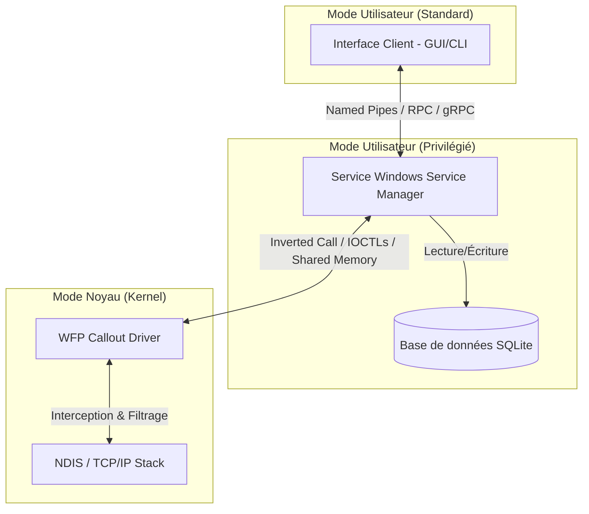

# Architecture de Monitoring et Filtrage Réseau (WFP)

## 1. Schéma de Communication Global (Driver <-> Service <-> UI)

Le système repose sur trois couches distinctes : le Noyau (Kernel-mode), le Service (User-mode privilégié) et l'Interface Client (User-mode standard).



### Mécanismes de Communication
- **Driver ↔ Service** : 
  - **Télémétrie (Haut débit)** : L'utilisation d'un *Inverted Call Model* (le service envoie des IRPs asynchrones au driver qui les met en attente et les complète quand des données arrivent) ou d'un *Ring Buffer* en mémoire partagée (très performant pour les logs réseau à haut débit).
  - **Contrôle (Règles)** : IOCTLs standards envoyés par le service vers le *Control Device Object* (CDO) du driver pour ajouter/supprimer des règles.
- **Service ↔ UI** : 
  - **IPC** : *Named Pipes* ou *gRPC/RPC local* pour permettre à l'UI d'envoyer des requêtes (ex: "bloquer ce PID") et de recevoir des flux de télémétrie en direct.

## 2. Persistance et Chargement des Règles

La persistance des règles (blocage par IP ou PID) est gérée par le Service Windows.
1. **Stockage** : Les règles persistantes sont stockées dans la base SQLite gérée par le service. Il n'est pas recommandé de stocker des listes complexes dans le Registre Windows.
2. **Séquence de démarrage** :
   - Au démarrage, le driver se charge (StartType = `SERVICE_SYSTEM_START` ou `SERVICE_DEMAND_START`). Il se met en mode "Block All" (Fail-safe) ou "Allow All" en fonction de la politique par défaut.
   - Le Service Windows démarre ensuite. Il lit la base SQLite.
   - Le Service injecte les règles de filtrage dynamiques au driver via IOCTL.
   - Le Service signale au driver qu'il est prêt à recevoir la télémétrie.

## 3. Structure de Stockage des Logs (Schéma SQLite)

Le service stocke l'historique de la télémétrie dans une base locale.

```sql
-- Table des connexions réseau
CREATE TABLE NetworkLogs (
    LogId INTEGER PRIMARY KEY AUTOINCREMENT,
    Timestamp DATETIME DEFAULT CURRENT_TIMESTAMP,
    ProcessId INTEGER NOT NULL,
    ProcessPath TEXT,
    Protocol TEXT NOT NULL, -- 'TCP', 'UDP', 'ICMP', etc.
    SourceIp TEXT NOT NULL,
    SourcePort INTEGER NOT NULL,
    DestIp TEXT NOT NULL,
    DestPort INTEGER NOT NULL,
    DataBytesIn INTEGER DEFAULT 0,
    DataBytesOut INTEGER DEFAULT 0,
    Action TEXT CHECK(Action IN ('ALLOWED', 'BLOCKED'))
);

-- Table des règles de filtrage (Persistance)
CREATE TABLE FilterRules (
    RuleId INTEGER PRIMARY KEY AUTOINCREMENT,
    RuleType TEXT CHECK(RuleType IN ('BLOCK_IP', 'BLOCK_PID', 'ALLOW_IP', 'ALLOW_PID')),
    TargetValue TEXT NOT NULL, -- Ex: '192.168.1.50' ou '1234'
    Direction TEXT CHECK(Direction IN ('INBOUND', 'OUTBOUND', 'BOTH')),
    IsActive INTEGER DEFAULT 1,
    CreatedAt DATETIME DEFAULT CURRENT_TIMESTAMP
);

CREATE INDEX idx_timestamp ON NetworkLogs(Timestamp);
CREATE INDEX idx_processid ON NetworkLogs(ProcessId);
```

## 4. Sécurité du Pilote et Signature

Sous Windows (notamment Windows 10/11 x64), tout pilote s'exécutant dans l'espace noyau doit posséder une signature numérique valide.

### En phase de Développement
1. **Mode TestSigning** : Activez le mode de test sur la machine virtuelle cible (`bcdedit /set testsigning on`).
2. **Signature de Test** : Créez un certificat auto-signé (via `MakeCert` ou `New-SelfSignedCertificate`) et signez le fichier `.sys` avec `SignTool`. Installez ce certificat dans le magasin "Autorités de certification racines de confiance" de la machine cible.

### Pour la Production (Déploiement public)
1. **Certificat EV Code Signing** : Vous devez acheter un certificat Extended Validation (EV) Code Signing (souvent fourni sur un token USB matériel).
2. **Windows Hardware Developer Center (Sysdev)** : Microsoft exige désormais que les pilotes kernel soient signés par leur portail (WHQL / Attestation Signing).
   - Créez un compte Microsoft Hardware Developer.
   - Signez un fichier `.cab` contenant votre pilote avec votre certificat EV.
   - Soumettez-le au portail pour obtenir l'**Attestation Signing** (signature croisée par Microsoft).

## 5. Exemple de Code (C/C++) : Driver Callout WFP

Voici un extrait simplifié montrant l'enregistrement d'un Callout WFP et la fonction de classification (Classify) qui extrait les métadonnées de connexion. Cet exemple cible la couche `FWPM_LAYER_ALE_AUTH_CONNECT_V4` (connexions sortantes IPv4).

```cpp
#include <ntddk.h>
#include <wdf.h>
#include <fwpmk.h>
#include <fwpsk.h>

// GUID pour notre Callout (A générer avec uuidgen)
// {A1B2C3D4-E5F6-7890-1234-567890ABCDEF}
DEFINE_GUID(WFP_MONITOR_CALLOUT_GUID, 0xa1b2c3d4, 0xe5f6, 0x7890, 0x12, 0x34, 0x56, 0x78, 0x90, 0xab, 0xcd, 0xef);

// Identifiant d'enregistrement du Callout
UINT32 g_CalloutId = 0;

// Fonction appelée à chaque fois qu'une connexion est interceptée
void NTAPI CalloutClassifyFn(
    _In_ const FWPS_INCOMING_VALUES0* inFixedValues,
    _In_ const FWPS_INCOMING_METADATA_VALUES0* inMetaValues,
    _Inout_opt_ void* layerData,
    _In_opt_ const void* classifyContext,
    _In_ const FWPS_FILTER3* filter,
    _In_ UINT64 flowContext,
    _Inout_ FWPS_CLASSIFY_OUT0* classifyOut)
{
    UNREFERENCED_PARAMETER(layerData);
    UNREFERENCED_PARAMETER(classifyContext);
    UNREFERENCED_PARAMETER(filter);
    UNREFERENCED_PARAMETER(flowContext);

    // Droit d'écriture sur classifyOut
    if (!(classifyOut->rights & FWPS_RIGHT_ACTION_WRITE)) {
        return;
    }

    // 1. Récupération des informations IP et Port
    UINT32 localIp = inFixedValues->incomingValue[FWPS_FIELD_ALE_AUTH_CONNECT_V4_IP_LOCAL_ADDRESS].value.uint32;
    UINT32 remoteIp = inFixedValues->incomingValue[FWPS_FIELD_ALE_AUTH_CONNECT_V4_IP_REMOTE_ADDRESS].value.uint32;
    UINT16 localPort = inFixedValues->incomingValue[FWPS_FIELD_ALE_AUTH_CONNECT_V4_IP_LOCAL_PORT].value.uint16;
    UINT16 remotePort = inFixedValues->incomingValue[FWPS_FIELD_ALE_AUTH_CONNECT_V4_IP_REMOTE_PORT].value.uint16;

    // 2. Récupération des métadonnées (Process ID)
    UINT64 processId = 0;
    if (FWPS_IS_METADATA_FIELD_PRESENT(inMetaValues, FWPS_METADATA_FIELD_PROCESS_ID)) {
        processId = inMetaValues->processId;
    }

    // 3. Logique de décision (Ex: Autoriser par défaut)
    // Ici, vous consulteriez vos structures de données internes (règles)
    BOOLEAN bBlock = FALSE; 
    
    /* 
       // Exemple de logique de filtrage
       if (bBlock) {
           classifyOut->actionType = FWP_ACTION_BLOCK;
           classifyOut->flags |= FWPS_CLASSIFY_OUT_FLAG_CLEAR_ACTION_RIGHT;
       }
    */
    
    if (!bBlock) {
        classifyOut->actionType = FWP_ACTION_PERMIT;
        // On ne clear pas le droit, pour laisser d'autres filtres décider le cas échéant
    }

    // TODO: Envoyer (localIp, remoteIp, processId, etc.) dans le Ring Buffer
    // pour que le Service en mode utilisateur puisse les lire.
}

// Fonction de notification du Callout
NTSTATUS NTAPI CalloutNotifyFn(
    _In_ FWPS_CALLOUT_NOTIFY_TYPE notifyType,
    _In_ const GUID* filterKey,
    _Inout_ const FWPS_FILTER3* filter)
{
    // Gérer les notifications d'ajout/suppression de filtre
    return STATUS_SUCCESS;
}

// Fonction de nettoyage d'état (Flow Delete)
void NTAPI CalloutFlowDeleteFn(
    _In_ UINT16 layerId,
    _In_ UINT32 calloutId,
    _In_ UINT64 flowContext)
{
    // Nettoyer le contexte lié au flux si alloué
}

// Enregistrement du Callout WFP (à appeler depuis DriverEntry ou EvtDriverDeviceAdd)
NTSTATUS RegisterWfpCallout(PDEVICE_OBJECT deviceObject)
{
    FWPS_CALLOUT0 sCallout = {0};
    
    sCallout.calloutKey = WFP_MONITOR_CALLOUT_GUID;
    sCallout.classifyFn = (FWPS_CALLOUT_CLASSIFY_FN0)CalloutClassifyFn;
    sCallout.notifyFn = (FWPS_CALLOUT_NOTIFY_FN0)CalloutNotifyFn;
    sCallout.flowDeleteFn = (FWPS_CALLOUT_FLOW_DELETE_FN0)CalloutFlowDeleteFn;
    
    // Enregistrement auprès du moteur de filtrage
    NTSTATUS status = FwpsCalloutRegister0(
        deviceObject,
        &sCallout,
        &g_CalloutId
    );
    
    if (!NT_SUCCESS(status)) {
        KdPrint(("FwpsCalloutRegister0 a echoue: 0x%X\n", status));
    }
    
    return status;
}
```

## Précautions de Développement

1. **Allocations Mémoire (IRQL)** : Dans le noyau, les routines Callout comme `ClassifyFn` peuvent être appelées à l'IRQL `DISPATCH_LEVEL`. À ce niveau, vous ne pouvez utiliser que de la mémoire non paginée (`NonPagedPool`). Tout accès à de la mémoire paginée causera un BSOD.
2. **Synchronisation** : Utilisez des *Spinlocks* pour synchroniser l'accès à vos listes de règles ou buffers de télémétrie, mais gardez le code extrêmement rapide pour ne pas dégrader les performances réseau du système entier.
3. **VM et Débogage** : Ne testez **JAMAIS** un pilote en développement sur votre machine hôte physique. Configurez une VM avec un port série virtuel ou KDNET et attachez WinDbg depuis l'hôte.
